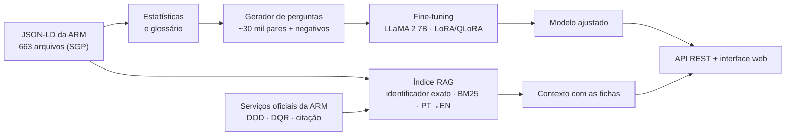

# Assistente de metadados ambientais

**Modelo de linguagem especializado nos metadados do repositório ARM: responde em português, em linguagem natural, que dados existem, onde estão e o que significam, e recusa quando a informação não está nos metadados.**

[](https://github.com/Nacpa17/assistente-metadados-ambientais/actions/workflows/testes.yml)

[](https://colab.research.google.com/github/Nacpa17/assistente-metadados-ambientais/blob/main/notebooks/IC_treino_colab.ipynb)

Iniciação Científica · PIBIC INPE/CNPq · metadados da ARM (Atmospheric Radiation Measurement)

> Pesquisadores perguntam *"qual instrumento mede umidade em Southern Great Plains?"*, *"o que é mean_doppler_velocity?"* ou *"qual o DOI do 1twrmr?"*, e o assistente responde a partir dos metadados JSON-LD da ARM, em vez de exigir que eles naveguem por arquivos difíceis de manusear.

**English summary.** A Portuguese-language assistant for the metadata of the ARM (Atmospheric Radiation Measurement) data archive. LLaMA 2 7B Chat is fine-tuned with LoRA/QLoRA on about 30,000 question-answer pairs generated from 663 JSON-LD metadata files of the Southern Great Plains observatory, including negative examples that teach the model to refuse. A retrieval layer (RAG) places the right metadata record in the prompt, so the model reads exact facts such as DOIs, dates and coordinates instead of memorizing them. The system is served through a REST API with streaming and a web chat interface.

## Sumário

- [Resultados](#resultados)
- [Como funciona](#como-funciona)
- [Início rápido](#início-rápido)
- [Uso](#uso)
- [Estrutura do repositório](#estrutura-do-repositório)
- [Dados](#dados)
- [Próximos passos](#próximos-passos)
- [Documentação](#documentação)
- [Referências](#referências)
- [Créditos](#créditos)

## Resultados

**Fase 2 (fine-tuning)**, relatório final de julho de 2026, no benchmark anotado `benchmarks/gold_qa.jsonl`:

| Métrica | Valor |
|---|---|
| BLEU | 43,2 |
| ROUGE-L | 0,56 |
| F1 de tokens | 0,55 |
| Acurácia de recusa | 0,83 |

O modelo vai bem em definições conceituais, na recusa de perguntas fora de escopo e na recomendação de conjuntos de dados. O limite principal é a recordação exata de fatos únicos por identificador (DOIs, datas, nomes de produtos), típico do fine-tuning: isso motivou a fase 3.

**Fase 3 (RAG, em andamento):** a busca, o contexto e a avaliação híbrida estão prontos e cobertos por testes. Os números das 4 combinações (modelo base e fine-tuning, com e sem RAG) ainda vão ser medidos no Colab.

## Como funciona



1. **Coleta e auditoria**: coletor do JSON-LD da ARM com nomes únicos e procedência, clientes dos serviços oficiais da ARM (DOD, DQR, citação, índice) e auditoria do corpus.
2. **Dataset**: estatísticas do corpus, glossário técnico (curado e automático), gerador de perguntas e respostas e negativos que ensinam o modelo a recusar.
3. **Fine-tuning**: `meta-llama/Llama-2-7b-chat-hf` com adaptadores LoRA (rank 16) e quantização em 4 bits (QLoRA), com progresso, tempo restante e retomada de checkpoints.
4. **RAG**: fichas por conjunto de dados, termo, variável e observatório; busca por identificador exato com BM25 e ponte português → inglês; o contexto entra no mesmo formato de prompt do treino, com orçamento de tamanho.
5. **Avaliação**: exact match, F1, BLEU, ROUGE-L, acurácia de recusa, `contains_gold` e taxa de recusa indevida, por tipo de pergunta; Recall@k e MRR da busca.
6. **Serviço**: API FastAPI com respostas em tempo real (SSE), interface web no estilo do DataMap e conversa pelo terminal.

## Início rápido

### Google Colab (treino e avaliação)

Clique em **Abrir no Colab** (no topo desta página), escolha uma GPU e use **Ambiente de execução → Executar tudo**. O notebook usa a pasta do projeto no seu Google Drive ou clona este repositório lá, aproveita os dados de versões antigas do projeto no Drive, só gera o dataset e só treina se ainda não existirem, e avalia as 4 combinações. O LLaMA 2 exige aceitar a [licença](https://huggingface.co/meta-llama/Llama-2-7b-chat-hf) e um token do Hugging Face.

### Local

```bash
git clone https://github.com/Nacpa17/assistente-metadados-ambientais.git
cd assistente-metadados-ambientais
pip install torch                          # a versão da sua máquina (CUDA ou CPU)
python -m pip install -e ".[completo,dev]"
python -m pytest
```

Rode os comandos a partir da raiz do repositório. O passo a passo para Windows e VSCode está no [guia completo](docs/guia_completo.md).

## Uso

```bash
# dataset: estatísticas, glossário, perguntas e negativos
python -m assistente_metadados.analytics.compute --in data/raw_json --out data/analytics/stats.json
python -m assistente_metadados.glossary.build --json-dir data/raw_json --out data/glossary/glossary_full.json
python -m assistente_metadados.prompts.generator --config configs/dataset_v3.yaml
python -m assistente_metadados.prompts.add_negatives --dataset data/processed/dataset_v3.jsonl --json-dir data/raw_json --n 2500

# fine-tuning (--resume continua do último checkpoint)
python -m assistente_metadados.training.train --config configs/exp01.yaml

# RAG: índice, busca e Recall@k
python -m assistente_metadados.rag.build_index
python -m assistente_metadados.rag.search "Qual o DOI de 1twrmr?" --contexto
python -m assistente_metadados.rag.eval_retrieval

# avaliação (--baseline para o modelo base, --rag para usar a busca)
python -m assistente_metadados.eval.run_eval --config configs/exp01.yaml --benchmark benchmarks/gold_qa.jsonl --rag

# interface web e API em http://localhost:8000 (IC_RAG=1 liga o RAG)
IC_CONFIG_PATH=configs/exp01.yaml python -m assistente_metadados.api.server
```

## Estrutura do repositório

```
assistente-metadados-ambientais/
├── assistente_metadados/         pacote Python
│   ├── collect/                  coleta, serviços oficiais da ARM e auditoria
│   ├── analytics/, glossary/     estatísticas do corpus e glossário técnico
│   ├── prompts/                  gerador de perguntas e negativos
│   ├── training/                 fine-tuning com LoRA/QLoRA
│   ├── rag/                      fichas, busca, contexto e avaliação da recuperação
│   ├── eval/                     métricas, avaliação e reavaliação
│   ├── api/                      API, streaming e conversa pelo terminal
│   └── common/                   formato de prompt e utilitários
├── configs/                      coleta, dataset e treino (local e Colab)
├── data/                         glossário curado e ponte PT→EN (o resto é gerado)
├── benchmarks/gold_qa.jsonl      benchmark anotado
├── frontend/index.html           interface web de conversa
├── notebooks/IC_treino_colab.ipynb
├── docs/                         guia completo e análise das fontes da ARM
├── scripts/                      pipeline completo (Linux/macOS e Windows)
├── tests/                        testes automáticos (rodam no GitHub Actions)
├── pyproject.toml
└── CHANGELOG.md
```

## Dados

O corpus JSON-LD, o dataset gerado, o índice do RAG e os checkpoints não entram no repositório (veja o `.gitignore`). Ponha os arquivos JSON-LD da ARM em `data/raw_json/`, ou colete com `python -m assistente_metadados.collect.arm_collector --config configs/collect.yaml`. Os testes usam um mini-corpus sintético e não precisam desses dados, de internet nem de GPU.

## Próximos passos

- [ ] Medir as 4 combinações (modelo base e fine-tuning, com e sem RAG) no Colab e registrar os números.
- [ ] Ampliar o corpus com novos observatórios da ARM (ex.: MAO, do GoAmazon) e com dados do INPE.
- [ ] Novo ciclo de fine-tuning com o corpus ampliado.
- [ ] Ampliar o benchmark anotado.
- [ ] Colocar o assistente em produção no DataMap.
- [ ] Suporte multilíngue e avaliação de usabilidade.

A geração de arquivos NetCDF a partir dos dados brutos, com agentes, continua no repositório [geracao-netcdf-agentes](https://github.com/Nacpa17/geracao-netcdf-agentes).

## Documentação

- [Guia completo](docs/guia_completo.md): instalação do zero, pipeline passo a passo, treino com pausa e retomada, RAG, interface, API e solução de problemas.
- [Fontes de metadados da ARM](docs/fontes_metadados_arm.md): análise dos serviços oficiais usados na fase 3.

## Referências

- Touvron, H. et al. Llama 2: Open Foundation and Fine-Tuned Chat Models. arXiv:2307.09288, 2023.
- Hu, E. J. et al. LoRA: Low-Rank Adaptation of Large Language Models. arXiv:2106.09685, 2021.
- Dettmers, T. et al. QLoRA: Efficient Finetuning of Quantized LLMs. arXiv:2305.14314, 2023.
- Lewis, P. et al. Retrieval-Augmented Generation for Knowledge-Intensive NLP Tasks. NeurIPS, 2020.
- Robertson, S.; Zaragoza, H. The Probabilistic Relevance Framework: BM25 and Beyond. *Foundations and Trends in Information Retrieval*, v. 3, n. 4, p. 333–389, 2009.
- Papineni, K. et al. BLEU: a Method for Automatic Evaluation of Machine Translation. ACL, 2002.
- Lin, C.-Y. ROUGE: A Package for Automatic Evaluation of Summaries. ACL Workshop on Text Summarization Branches Out, 2004.

## Créditos

| | |
|---|---|
| Bolsista | Eduardo Ribeiro do Amparo Rodrigues de Souza |
| Orientador | Dr. Alan James Peixoto Calheiros (INPE) |
| Coorientador | Prof. Dr. Pedro Luiz Pizzigatti Corrêa (Escola Politécnica da USP) |
| Programa | PIBIC INPE/CNPq |
